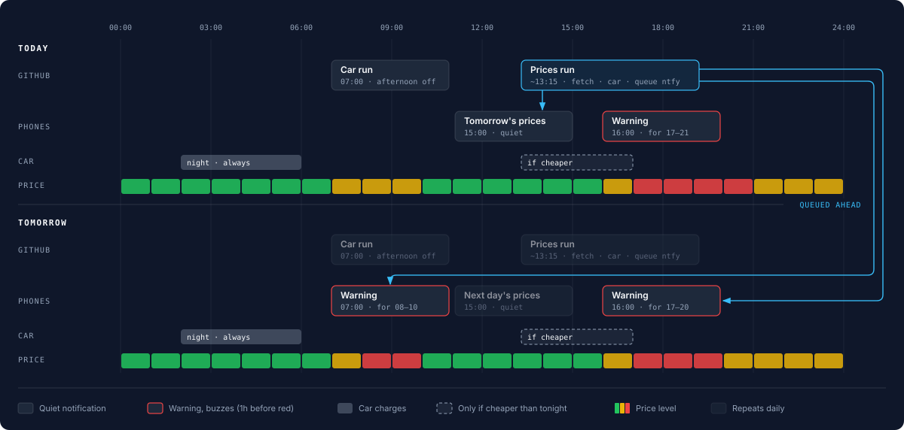

# Hourly Electricity Price Chart

A clean, responsive web application to visualize hourly electricity prices for Today and Tomorrow, optimized for mobile and tablet viewing — plus push notifications to the family's phones before prices get expensive.

## Features

- **Dual Charts**: Compare Today's prices with Tomorrow's prices side-by-side.
- **Right Now**: Today's chart opens with the current price, its level and when it changes; past hours are dimmed and the current one is outlined. The page refreshes itself every hour.
- **Synchronized Scaling**: Both charts share the same Y-axis scale for accurate visual comparison.
- **Price Thresholds** (total price incl. tariffs and VAT):
  - Green below **2.1 DKK/kWh**.
  - Yellow below **3.2 DKK/kWh**, red above.
- **Push Notifications** via [ntfy](https://ntfy.sh): a warning an hour before each expensive period, plus a quiet overview of tomorrow at 15:00.
- **Tesla Charging**: the car's afternoon charge schedule is only switched on when the afternoon is cheaper than the night after (optional).
- **Responsive Design**: Glassmorphism UI that looks great on all devices.
- **Installable**: "Add to Home Screen" opens it full-screen like an app, with its own icon.

## How it works

The GitHub Action (`.github/workflows/deploy.yml`) does two jobs a day, plus a prices run on every push. All times are Copenhagen:



```
Prices run, tried at 13:15, 13:45, 14:15 and 14:45; tomorrow's prices come out around 13:00
   │
   ├─► 1. scripts/fetch-prices.mjs   fetches today + tomorrow from stromligning.dk and plans
   │                                 when the car charges → data/prices.json
   │                                 (once a day: skipped when tomorrow's prices are already there)
   ├─► 2. scripts/tesla-charge.mjs   switches the car's afternoon charging on if it's cheaper than tonight
   │                                 (remembers what the car was set to in data/charge.json)
   ├─► 3. scripts/notify.mjs         hands ntfy all of tomorrow's notifications, each with its delivery time
   │                                 (remembers what it queued in data/notified.json)
   ├─► 4. commits data/ back to the repo (only when something changed)
   └─► 5. deploys the site to GitHub Pages

Car run at 07:00 with a second try at 09:00
   │
   ├─► scripts/tesla-charge.mjs      switches the afternoon charging back off
   └─► commits data/charge.json
```

GitHub often starts scheduled runs hours late or skips them, so [cron-job.org](https://cron-job.org) starts the runs on time instead (see [Setup](#setup)). The workflow keeps its own schedule as a backup, in UTC, so it runs an hour earlier in winter. Each job has a few tries: the first one that finds something to do does it, and the rest change nothing. Notifications don't depend on when a run starts: [ntfy holds each message](https://docs.ntfy.sh/publish/#scheduled-delivery) and delivers it at its time. Only tomorrow's overview can be late, if no prices run gets through before 15:00.

The web page only reads `data/prices.json`; it never calls the price API itself.

Notifications:

| Notification | When | Sound |
| --- | --- | --- |
| **Expensive hours warning** | An hour before each red period, moved to 07:00 if that's earlier (or to 21:00 if later) | 🔔 Buzzes |
| **Tomorrow's prices** | 15:00, or as soon as they're out if that's later | 🔕 Silent |

Only the warning makes a sound, so a buzz always means "hold off soon". The overview just sits in the notification list. A red period that's over before 07:00 gets no warning.

```
⚠️ Expensive electricity 17:00–21:00
Up to 3.65 kr/kWh. Hold off on the dishwasher, laundry and dryer.
✅ Cheapest after: 03:00–06:00 · avg 1.70 kr
```

```
⚡ Tomorrow's prices · Sun 18 Oct
🔴 Avoid 17:00–21:00 · up to 3.65 kr
✅ Cheapest 3h: 03:00–06:00 · avg 1.70 kr

00 🟢🟢🟢🟢🟢🟢🟢🟡🟡🟡🟡🟡
12 🟡🟡🟡🟡🟡🔴🔴🔴🔴🟡🟡🟡
```

Tapping the notification opens the chart.

With [Tesla charging](#tesla-charging) set up, 🚙 marks the hours the car charges, both in the notifications and above the bars on the site (from the plan in `data/prices.json`). Tomorrow's overview also says whether it charges this afternoon or tonight. The car is blue so it never looks like a price warning:

```
🚙 Car charges tonight 02:00–06:00 · avg 1.80 kr (this afternoon 2.40 kr)

00 🟢🟢🚙🚙🚙🚙🟢🟡🟡🟡🟡🟡
```

## Source Data

Data is fetched from the [stromligning.dk API](https://stromligning.dk/api/docs) for the "Andel Energi Timeenergi" product. The product, supplier and color thresholds are set at the top of `scripts/fetch-prices.mjs`:

```js
const PRODUCT_ID = 'andel_energi_timeenergi';
const SUPPLIER_ID = 'cerius_c';
const THRESHOLDS = { low: 2.1, high: 3.2 };
```

## Setup

1. **Secret**: in the repo, go to *Settings → Secrets and variables → Actions → New repository secret* and add `NTFY_TOPIC` with the ntfy topic name (or full topic URL). Anyone who knows the topic can read and send to it, so never commit it.
2. **Phones**: install the ntfy app ([Android](https://play.google.com/store/apps/details?id=io.heckel.ntfy) / [iOS](https://apps.apple.com/app/ntfy/id1625396347)), tap **+** and subscribe to the same topic on `ntfy.sh`.
3. **Test**: *Actions → Update prices & deploy → Run workflow*, and choose `tomorrow` or `reminder` to send one right away. Choose the `car` task to run the morning car switch.
4. **On-time runs**: GitHub's schedule is often hours late, so cron-job.org starts the runs instead.
   - Create a [fine-grained GitHub token](https://github.com/settings/personal-access-tokens/new) for this repo only, with *Actions: Read and write*, and put it in `.env` as `GITHUB_DISPATCH_TOKEN`.
   - Create an API key at *cron-job.org → Settings → API* and put it in `.env` as `CRONJOB_ORG_API_TOKEN`.
   - Run `node scripts/cron-job-setup.mjs` (add `--dry-run` to preview). It creates the two jobs, or updates them if they're already there. Run it again with a new token before the old one expires; cron-job.org emails you if the calls start failing.
5. **Install** (optional): open the site on the phone, then *Share → Add to Home Screen* (iPhone) or *⋮ → Add to Home screen* (Android).

## Local Development

No dependencies or build step, just Node.js 18+.

```bash
node scripts/fetch-prices.mjs      # refresh data/prices.json (add --force once tomorrow's are in)
node scripts/notify.mjs --dry-run  # preview what would be queued, and when it'd arrive
node scripts/notify.mjs tomorrow --dry-run
node scripts/notify.mjs reminder --dry-run
node ./server.js                   # http://localhost:3001
```

The diagram is `docs/schedule.svg`, exported from `docs/schedule.html`.

The workflow commits `data/` a few times a day, so `git pull --rebase` before pushing.

## Tesla Charging

The car has two charge schedules: 02:00–06:00, which is always on, and 12:00–17:00, which this repo turns on and off.

- The afternoon schedule is **off by default**, so the car waits for the night.
- When tomorrow's prices are published (~13:00), `fetch-prices.mjs` compares the rest of the afternoon with tomorrow's 02:00–06:00 and writes the day's decision into `data/prices.json` as `charging`. The Tesla step, the notifications and the chart all read that one plan. If the afternoon is cheaper on average, the schedule goes **on** until 17:00.
- The next morning's car run (07:00) switches it back off, before it would start again at 12:00.

The car is only woken when the schedule actually has to change, about twice on an "afternoon" day and not at all otherwise. Tesla bills this well inside its $10 monthly free credit. The windows are set at the top of `scripts/charging.mjs`. If you change the times in the car, change them there too.

Tesla only accepts signed commands from cars made since 2021, so the workflow builds Tesla's [`tesla-control`](https://github.com/teslamotors/vehicle-command) and signs them with a private key. The car trusts the matching public key, which is hosted at `https://balexandre.github.io/.well-known/appspecific/com.tesla.3p.public-key.pem` (from the `balexandre.github.io` repo).

The workflow patches `tesla-control` before building it (`.github/tesla-control-schedule-id.patch`). Without the patch it ignores the schedule ID and adds a new schedule on every switch, instead of switching the existing one.

### One-time setup

These scripts need Node.js 20.12+.

1. **Tesla app**: on [developer.tesla.com](https://developer.tesla.com), create an app with:
   - Allowed origin `https://balexandre.github.io`
   - Redirect URI `http://localhost:3002/callback`
   - Scopes: vehicle information, location, commands and charging management
   - A payment method on file

   Put its `TESLA_CLIENT_ID` and `TESLA_SECRET` in `.env`.
2. **Key**: generate a key pair into `.tesla/` (gitignored), and publish the public key at the URL above:
   ```bash
   mkdir -p .tesla
   openssl ecparam -name prime256v1 -genkey -noout -out .tesla/private-key.pem
   openssl ec -in .tesla/private-key.pem -pubout -out .tesla/com.tesla.3p.public-key.pem
   ```
3. **Register and sign in**:
   ```bash
   node scripts/tesla-setup.mjs register   # tells Tesla's EU region about the domain and key
   node scripts/tesla-setup.mjs login      # signs in through the browser, saves .tesla/token.json
   ```
4. **Pair**: on the phone with the Tesla app, open `https://tesla.com/_ak/balexandre.github.io` and approve the key.
5. **Find the schedule**: `TESLA_VIN=… node scripts/tesla-setup.mjs schedules` lists the car's schedules and their ids. Use `node scripts/tesla-setup.mjs vehicles` to get the VIN.
6. **GitHub**: under *Settings → Secrets and variables → Actions*, add these repository secrets:

   | Secret | Value |
   | --- | --- |
   | `TESLA_CLIENT_ID` | from the Tesla app |
   | `TESLA_VIN` | the car's VIN |
   | `TESLA_SCHEDULE_ID` | the afternoon schedule's id |
   | `TESLA_PRIVATE_KEY` | contents of `.tesla/private-key.pem` |
   | `TESLA_REFRESH_TOKEN` | `jq -r .refresh_token .tesla/token.json \| gh secret set TESLA_REFRESH_TOKEN` |
   | `TESLA_GH_TOKEN` | a fine-grained token for this repo with *Secrets: read and write* |

   Tesla refresh tokens work only once. Every time the workflow uses one, it saves the new one back into `TESLA_REFRESH_TOKEN` with `TESLA_GH_TOKEN`. Once the secret is set, don't run the scripts locally with the same token, or the two copies will fall out of step. If the workflow reports `login_required`, run `login` again and update the secret.

```bash
node scripts/tesla-charge.mjs --dry-run   # what it would do right now
node scripts/tesla-charge.mjs on          # switch the afternoon schedule on (or off) right now
```

## Technologies

- **HTML5 / CSS3**: Vanilla implementation for maximum performance.
- **JavaScript (ES6+)**: Module-based logic.
- **Chart.js**: For data visualization.
- **Lucide Icons**: For UI elements.
- **Node.js**: Data fetching, notifications and a minimal static server for local testing.
- **GitHub Actions + Pages**: Scheduling and hosting.
- **ntfy**: Push notifications.
